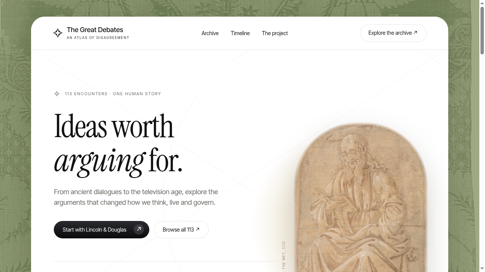

# The Great Debates

**An atlas of disagreement** - a hall-of-fame website for history's great debates, from ancient dialogues to the television age.

**Live:** [great-debates.vercel.app](https://great-debates.vercel.app)



## About

113 historical encounters, each with its own dedicated page: the two sides and their positions, a neutral summary, why the debate mattered, and how the historical record qualifies it - with sources. Entry numbers are editorial order, not objective rankings. Historical dialogues, coercive disputations, trials and uncertain accounts are labeled as such. No fabricated quotations or placeholders.

Built as an independent static editorial website with HTML, CSS and browser-native JavaScript. No runtime dependencies or server are needed in production.

## Features

- **113 dedicated debate pages** at `/debate/<slug>`, with four expanded features on the home page
- **Archive** with full-text search, era filters, sorting and an empty-state reset
- **Chronological timeline** across all entries
- **Fact-checked content** with per-entry sources that open in a new tab
- **Editorial art direction** - classical public-domain artwork, damask textures, serif typography
- Responsive from 320px to desktop, with browser back/forward and entry pagination
- No analytics backend, accounts, forms or newsletters

## Tech stack

- HTML, CSS, vanilla JavaScript (no frameworks, no runtime dependencies)
- Node 18+ for the local server, build and content tests
- Deployed on Vercel as a static site with a single-page fallback (`vercel.json`)

## Getting started

Run locally (Node 18 or later):

```
npm start
```

Open http://localhost:4173.

Build for production:

```
npm run build
```

Deploy the contents of `dist/` to any static host. Equivalent hosts must rewrite unknown paths to `index.html`.

Validate the content:

```
npm test
```

`npm test` checks data continuity, all required fields, unique route slugs and sources. The application has been tested at 320, 390 and 1440 pixels, with 113 dedicated route checks, archive interactions and overflow checks.

## Project structure

```
public/            the whole site (served as-is, copied to dist/ on build)
  index.html       single-page shell
  app.js           routing, archive, timeline and debate pages
  debates.json     all 113 entries: chronology, sides, positions, summary, significance, sources
  assets/          fonts, paintings and textures (rights-cleared)
server.mjs         local dev server
build.mjs          static build (copies public/ to dist/)
tests/content.mjs  content validation
```

## Content notes

The current source set was recovered from an earlier study and corrected where possible. An independent per-entry QA fact sheet has been applied, correcting known errors and removing disputed causal claims, numbers and quotations. Some inherited citations lead to institutional index pages or inaccessible records rather than a complete transcript, so the archive is not presented as a complete transcript repository.

## Assets and licenses

Only rights-cleared assets are included: local OFL fonts (Instrument Serif, Inter Tight), The Met's CC0 drawings and damask derivatives, and Michelangelo's Creation of Adam (PD-Art reproduction). The reader-ink PNG is an editorial ink derivative of the credited Met drawing. Artwork is not presented as a likeness of any debate participant. Full attribution in [ASSET-LICENSES.md](ASSET-LICENSES.md).
